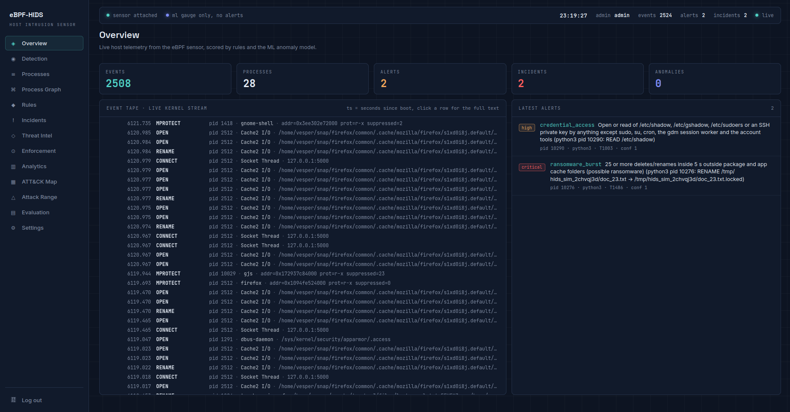
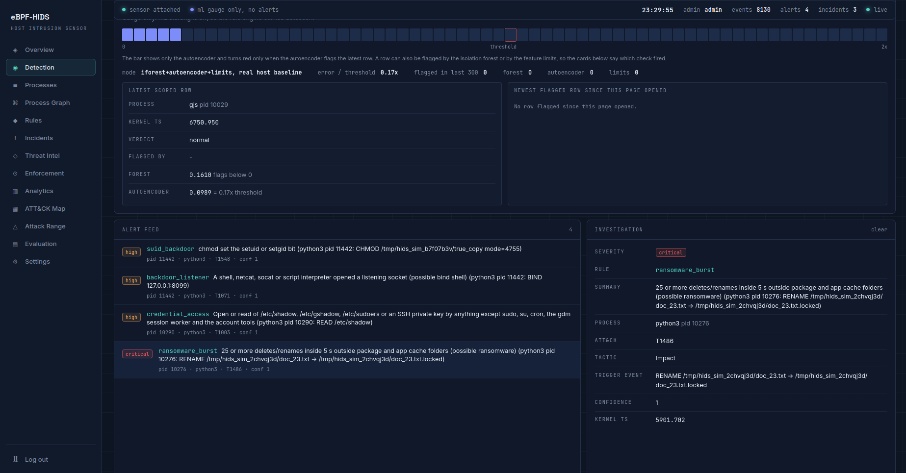
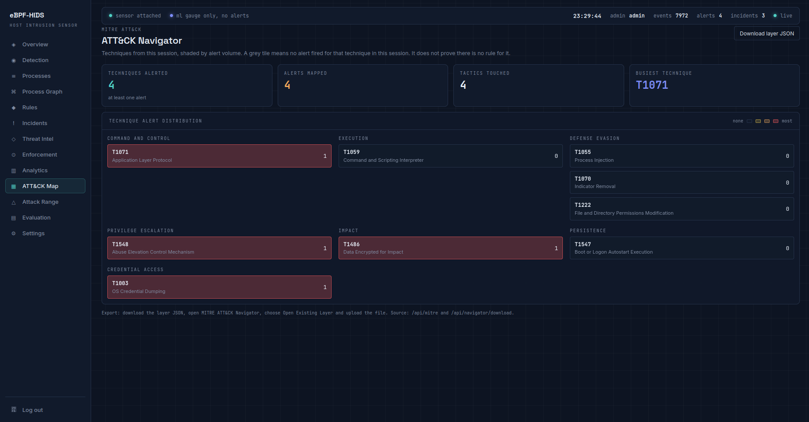
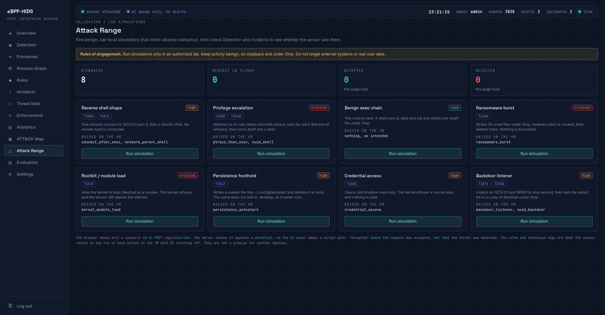

# ebpf-hids

Host intrusion detection for Linux, built on eBPF. Small programs in the kernel watch what processes do: execs, file writes, renames and deletes, chmod, connects and listening sockets, ptrace, setuid, executable memory, kernel module loads, and reads of /etc/shadow, /etc/sudoers and SSH keys. A loader prints one JSON line per event. A Python server runs those lines through 14 YAML rules and an anomaly model, groups alerts into incidents, keeps them in SQLite and can stop a process if you let it. A React console shows all of it in the browser.

It watches the one Linux machine it runs on. Five layers, five people, one repo.



## The five layers

| Layer | What it is | Main files | Built by |
|-|-|-|-|
| L1 | kernel sensor, plus an opt-in IPS | bpf/, loader/, Makefile | Rahul Bose |
| L2 | detection engine: rules, incidents, IOC matching, ATT&CK coverage | server/engine.py, server/rules_dsl.py, server/rules/, server/ingest.py, server/incidents.py, server/ioc.py, server/mitre.py | Subhrajit Naskar |
| L3 | anomaly model | server/ml_anomaly.py, the feature half of server/features.py, scripts/ | Manabendra Rana |
| L4 | backend: API, logins and roles, response, alerting, reports | server/app.py, server/pipeline.py, server/db.py, server/auth.py, server/config.py, server/response.py, server/alerting.py, server/reports.py, server/navigator.py | Rishabh Banerjee |
| L5 | SOC console | console/ | Anit Chakraborty |

Each layer came in as its author delivered it and was committed under the author's name. Rahul Bose then checked each one against the shared contracts, did the integration and the fixes after it, and wrote the attack range scripts in server/simulations/. `git log` shows who wrote what.

## How the pieces connect

```
kernel    eBPF programs, mostly on syscall tracepoints, one shared ring buffer
            |
loader    loader/loader, runs as root, prints one JSON line per event
            |  pipe
server    python3 -m server.app, runs as a normal user
            ingest, then the engine (YAML rules + anomaly score),
            then incidents, IOC matching, the responder and alerting
            SQLite in data/hids.db, JSON API under /api
            |  HTTP, 127.0.0.1:5000
console   React app built into console/dist, served by the same server
```

Only the loader needs root. The event format is in docs/sensor-contract.md. The sensor's `ts` is kernel time in seconds since boot, and it travels unchanged from the kernel to the console. Nothing on the way replaces it with wall-clock time.

## Run the whole thing on the Linux VM

You need a kernel 5.15 or newer with BTF, clang, libelf-dev, zlib1g-dev, bpftool, libbpf 1.4 (see the L1 section), Python 3.10 or newer, and Node 20.19 or newer, or 22.12 or newer. From the repo root:

    make
    python3 -m venv .venv
    . .venv/bin/activate
    pip install -r requirements.txt -r requirements-ml.txt
    cd console && npm ci && npm run build && cd ..
    export HIDS_ADMIN_PASS='choose a password'
    sudo ./loader/loader 2>/dev/null | python3 -m server.app

Open http://127.0.0.1:5000 and log in as admin.

HIDS_ADMIN_PASS is only read while data/hids.db has no users. The first start creates admin with it and later starts ignore it. Without it the server makes up a password and prints it once. Deleting data/hids.db* resets users, alerts and incidents together.

The anomaly model is not in git. Without model files in server/ml/ the server starts without ML and says so. Training is in the L3 section. console/dist is not in git either, so build it again after every pull.

Other flags: `--replay FILE` reads a captured file instead of the pipe, `--no-ingest` serves the API only, `--no-ml` skips the model, `--ml-alerting` lets the model raise alerts (off by default). HIDS_HOST and HIDS_PORT change the address.

Without the sensor, on any OS (on Windows activate with .venv\Scripts\Activate.ps1 and use python instead of python3):

    python3 -m server.app --replay samples/events.jsonl

That replays 160 captured events, which raise 3 alerts, and then keeps serving the API and the console. docs/DEMO_SCRIPT.md is the order used to show it.

## What it catches

14 rules in server/rules/*.yml, mapped to 9 ATT&CK techniques. All 14 have fired on the live sensor on the VM. docs/live-triggers.md has the commands that make each one fire.

| Rule | Technique | Severity |
|-|-|-|
| connect_after_exec | T1071 | medium |
| network_parent_shell | T1059 | high |
| ptrace_then_exec | T1055 | critical |
| suid_shell | T1548 | high |
| ransomware_burst | T1486 | critical |
| log_tampering | T1070 | high |
| persistence_autostart | T1547 | high |
| credential_access | T1003 | high |
| suid_backdoor | T1548 | high |
| world_writable_sensitive | T1222 | medium |
| code_injection_rwx | T1055 | high |
| kernel_module_load | T1547 | critical |
| backdoor_listener | T1071 | high |
| download_and_execute | T1059 | high |

The console's Attack Range page runs eight harmless scripts from server/simulations/ through the server. They refuse to run as root and only touch loopback, files under /tmp, and one marker file in ~/.config/autostart that is deleted at once. Some of them ask the kernel for things it refuses, like loading a module, reading /etc/shadow or setuid to root, and the sensor still reports the attempt because its hooks run at syscall entry. What each button raised on the VM on 2026-11-03, one click each, ML alerting off:

| Button | Rules raised |
|-|-|
| Reverse shell shape | connect_after_exec, network_parent_shell |
| Privilege escalation | ptrace_then_exec, suid_shell |
| Benign exec chain | none, it is the control case |
| Ransomware burst | ransomware_burst |
| Rootkit / module load | kernel_module_load |
| Persistence foothold | persistence_autostart |
| Credential access | credential_access |
| Backdoor listener | backdoor_listener, suid_backdoor |







## Measured

All on the Ubuntu VM (kernel 6.8), dated in docs/DEVLOG.md. Anything that only ran on synthetic data says so.

- Idle false alarms: 30 minutes of normal use with cron.hourly inside, 7115 events, 0 alerts (2026-10-27). After the rule changes of 2026-11-02, 3365 events over 28 minutes, 0 alerts.
- tests/measure_rules.py on hand-written events, not live data: 14 of 14 attack cases caught, 0 of 30 benign ones flagged.
- Sensor cost from kernel.bpf_stats_enabled: 60 ns for an open the kernel side filters out, 1159 ns per emitted event when the reader is woken only once 64 KB is waiting (2026-10-26). The loader counts dropped events and prints the count on exit. It read 0 in every live run where the DEVLOG records it.
- Prevention: with the IPS protecting a pid, `sudo strace -p` on it got "Operation not permitted" even as root (2026-10-27). With a path given, running /tmp/hids_blocked failed with exit 126 while /bin/true still ran (2026-11-02).
- Anomaly model, trained on three captures of normal use and run live on a fourth session it never saw (16.3 min, console open): 284 of 10716 events flagged, 2.65%, about 15 ML alerts an hour if alerting were on. During a scripted activity loop on 2026-11-02, the model on the VM flagged 1251 of 3583 events, 34.91%, and why is not known yet. That is why it is a gauge by default. On synthetic attacks it caught 64% on average over four seeds.
- Backend: all 41 route and method pairs called with no login and with each role. Anonymous got 401 on 39 and 200 on 2, viewer 403 on 18, analyst 403 on 12, admin no 403, nobody a 5xx (2026-11-02). Asked to stop pid 1, NetworkManager and the server itself, the responder refused all three (guard_blocked).
- 325 tests pass on the VM, and the console builds in 988 ms (2026-11-03).

## Known limits

- samples/events.jsonl was captured before the sensor changes of 2026-11-02, so it has no READ events and the old cut-off RENAME paths. It gets captured again at the end.
- A read of a sensitive file through ./ or ../ (cat ./shadow from inside /etc) is missed, and an SSH key read within 10 seconds of being created is missed.
- The IPS blocks exec by device and inode, so a copy of the blocked file still runs.
- Hash IOCs are stored but never match, because the sensor does not hash files.
- Most of what the anomaly model flags is busy Firefox threads. A row flagged by the isolation forest alone has not been seen live, only in a unit test.
- During a run on 2026-11-03, snapd raised ransomware_burst twice and persistence_autostart once. Probably false positives, not looked into yet.
- Enforcement and alerting settings changed from the console last until the server restarts, on purpose.
- There are no tests for the React code, only lint and the build.

## Building the L1 sensor (Linux only)

Needs kernel 5.15+ with BTF at /sys/kernel/btf/vmlinux, plus clang, libelf-dev, zlib1g-dev, bpftool and jq.

Ubuntu 22.04 ships libbpf 0.5.0, which can't read the BTF on a 6.8 kernel ("failed to find valid kernel BTF"). Build libbpf 1.4 once, outside the repo:

    git clone --depth 1 --branch v1.4.0 https://github.com/libbpf/libbpf.git ~/libbpf
    cd ~/libbpf/src
    make BUILD_STATIC_ONLY=y
    make install BUILD_STATIC_ONLY=y DESTDIR=$HOME/libbpf-install

Then from the repo root:

    make
    sudo ./loader/loader | jq -c .

Run it from the repo root, because the loader opens bpf/*.bpf.o by relative path. Add --correlate to also load the in-kernel connect/exec join.

bpf/vmlinux.h is generated by make from the local kernel and is not committed.
Output format is in docs/sensor-contract.md.

## Prevention (IPS), optional and off by default

The sensor only watches. A separate, opt-in program can also deny. It needs BPF-LSM enabled: add bpf to the lsm= list on the kernel command line (GRUB_CMDLINE_LINUX_DEFAULT) and reboot, then confirm with `cat /sys/kernel/security/lsm` (must contain bpf).

Build and run it (not built by plain make):

    make ips
    sudo ./loader/ips_enforce <pid-to-protect> [path-to-block-exec]

While running, any ptrace against that pid is denied with EPERM, including as root, and a BLOCK line is printed. With a path, running that file is denied too. The file is matched by device and inode, so ./name and hard links are caught, but a copy of the file is not. Ctrl+C disables it. With no path, exec blocking is off.

## L2 detection engine (Python, any OS)

Python 3.10 or newer. From the repo root:

    python3 -m venv .venv
    . .venv/bin/activate            (Windows PowerShell: .venv\Scripts\Activate.ps1)
    pip install -r requirements.txt
    python -m pytest
    python -m server.ingest tests/data/mock_events.jsonl

The last command replays a hand-written file in the sensor's format and prints one JSON alert per line. Counts go to stderr.

Live, on the Linux VM, from the repo root with the venv active:

    sudo ./loader/loader | python -m server.ingest

Only the loader needs root. Rules live in server/rules/*.yml and are loaded at start; a rule with a typo is skipped and reported, the others still load. Rule layer numbers and how they were measured are in docs/results.md.

## L3 anomaly layer (Python, any OS)

Learns what normal processes look like and scores every event's process against that. It knows nothing about attacks. From the repo root, venv active:

    pip install -r requirements.txt -r requirements-ml.txt
    python -m scripts.train_ml --sweep --check samples/events.jsonl

That trains on 2500 synthetic normal processes and prints false positives on held-out normal rows, detection on 100 synthetic attacks split by kind, and which processes in the sample got flagged and why. Models go to server/ml/ and are not committed; every machine trains its own. Add --repeat 4 to retrain with four more seeds and print the spread, so one lucky seed never ends up in a report.

An event is flagged if any of three checks says so. The Isolation Forest catches unusual combinations inside the range it saw in training. Five small autoencoders, averaged, catch rows they cannot rebuild. The limits catch anything 1.5 times past the largest value the baseline ever showed, on exec_count, ptrace_count, setuid_count, the write and connect rates, burst_rate and new destinations per second. The forest cannot see past its training range, which is why the limits exist.

Before the forest and the autoencoders see a row, counts and rates go through log1p so one busy Firefox does not squash everything else. Counts that only grow with age (lifetime, total writes, total connects, distinct files and destinations) are capped at the baseline maximum, so an old process is not suspicious for being old. A feature that never changed in training is left out, and two are always left out. hour_of_day, because a few capture sessions only cover a few hours of the day and the model would learn that normal only happens at those hours. uid, because sudo flips it between 1000 and 0 inside one process, and ran_as_root already says the process became root.

TensorFlow is only needed to train the autoencoders (`pip install tensorflow`, Python 3.12 or older on Windows). Their weights are saved as plain arrays in autoencoder.npz, so loading and scoring never need it. Without TensorFlow, training runs the forest and the limits only.

A model trained on synthetic data is gauge only: it scores, the console shows the scores, but it raises no alerts, because it flags most real processes (see docs/results.md). To train on the real host, capture 15 minutes or more of ordinary use on the VM with no attack tests running:

    python3 -c "import time; print(round(time.time() - time.monotonic()))"
    mkdir -p server/ml/captures
    sudo ./loader/loader > server/ml/captures/baseline.jsonl
    python3 -m scripts.capture_baseline server/ml/captures/baseline.jsonl --boot-epoch <number from the first line>
    python3 -m scripts.train_ml --baseline server/ml/baseline.npy --repeat 4 --check samples/events.jsonl

One session is not enough. Normal on a desktop depends heavily on what you happened to do, and a model trained on a light browsing session flags a heavy one. Capture at least two different sessions, turn each into its own .npy with capture_baseline -o, and train on all of them:

    python3 -m scripts.train_ml --baseline server/ml/baseline.npy server/ml/session2.npy --repeat 4

The false positive number that counts comes from a session the model never saw. Train on one session and --check the other, both ways round, then train on all of them and confirm on a fresh capture.

A model trained with --baseline is allowed to alert, and it does so only when the server runs with --ml-alerting. That assumes the host was clean while capturing; if it was already compromised, the model learns the compromise as normal.

The engine never imports this code. The backend loads the model with server.ml_anomaly.load_model() and hands it to Engine(anomaly_model=...). load_model() returns None and prints why if the files are missing, the model was saved by an older version of ml_anomaly.py, or the feature list in threshold.json does not match FEATURE_NAMES. score() also returns ae_anomaly, limit_anomaly and over_limit. The engine keeps them in each anomaly score row, so the console can show which check flagged a process.

## L4 backend (Python, any OS)

server/app.py starts everything: it reads events, runs them through the pipeline, and serves the API and the built console. Logins use a session cookie, and scripts can use API keys instead. The roles are viewer, analyst and admin, and every route checks the role on the server.

The responder can stop a process that raised an alert at or above its minimum severity, critical by default: SIGTERM, then SIGKILL after 3 seconds. It ships switched off and in dry run, so by default it only logs what it would have done. Before acting it refuses pids below 300, names on the never-kill list in server/config.py, and the server's own process tree.

Alerting sends new alerts of high severity and above to a webhook as a JSON POST, or to syslog over UDP, at most once per rule every 300 seconds. Responder and alerting settings are changed from the console and last until the server restarts. Reports are CSV files of alerts and incidents plus a printable HTML page per incident. /api/navigator/download gives a layer file for MITRE's ATT&CK Navigator.

## L5 console

console/ is the React app. console/README.md says what each page reads and what is not done. The Attack Range page posts a scenario name to /api/sim/<name>, and the server only starts the matching script from server/simulations/ if the name is on its whitelist in server/config.py.

## Docs

- docs/sensor-contract.md, the event format every layer reads
- docs/results.md, how the rules and the anomaly model were measured
- docs/live-triggers.md, commands that make each rule fire on the live sensor
- docs/DEMO_SCRIPT.md, the demo in order, with a fallback when the sensor will not load
- docs/DEVLOG.md, dated log of what was built, what was measured and what is still broken
- console/README.md, the console page by page
